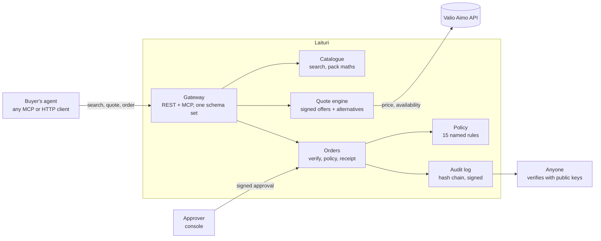

# Laituri

**The loading dock for AI agents.** An open, verifiable front door that lets a customer's own purchasing agent buy from Valio Aimo: look up products, get a signed fixed-price offer, and order, inside limits a person signed. When a limit is passed, a person signs off. Every step lands in a log anyone can verify.

Laituri is not a web shop and not a chatbot. It is the interface and the operating model between two parties' software.

> "1,000 litres of lactose-free milk by Monday."
> The agent searches, receives a wholesaler-signed offer for 1,000 x 1 l, presents its mandate, and the order confirms in seconds. Ask for more than the mandate allows, and the order waits for Maria.

## Run it

```bash
cp .env.example .env      # add VALIO_API_KEY
npm install
npm run setup             # downloads the product data once and builds the search index
npm run dev               # http://localhost:3210
```

No key? `VALIO_MODE=recorded npm run dev` replays recorded price and availability answers for 255 products.

| Command | What it does |
|---|---|
| `npm run dev` | Console at `/`, REST at `/api/v1`, MCP at `/mcp` |
| `npm test` | Unit and integration tests |
| `npm run eval` | The four automated eval suites, on recorded data with a fixed clock |
| `npm run eval -- --live` | Smoke subset against the live mock API |
| `npx tsx scripts/buyer-agent.ts "1,000 litres of lactose-free milk by Monday"` | An outside process buys over HTTP |

## Connect an agent

Point any MCP client at `https://<host>/mcp` (Streamable HTTP). Or read `/llms.txt` and use plain HTTP. The demo bearer token `demo-agent-token` identifies the agent named in the mandate.

| Tool (MCP) | REST | Purpose |
|---|---|---|
| `search_catalog` | `POST /api/v1/products/search` | Find products; pack maths and match confidence come back |
| `get_product` | `GET /api/v1/products/{id}` | One product with identifiers, allergens, claims |
| `request_quote` | `POST /api/v1/quotes` | Live price and availability as a signed fixed-price offer, plus signed alternatives |
| `get_mandate` | `GET /api/v1/mandate` | The signed mandate: what this agent may do alone |
| `place_order` | `POST /api/v1/orders` | Offer + mandate + idempotency key; returns confirmed, waiting or blocked |
| `get_order` | `GET /api/v1/orders/{id}` | Status and receipt |
| `verify_audit` | `GET /api/v1/audit/verify` | Chain check and signed checkpoint |

Discovery: `/api/v1/openapi.json`, `/.well-known/jwks.json`, `/.well-known/agent-card.json`, `/.well-known/ai-catalog.json`, `/.well-known/ucp`, `/llms.txt`.

## How it works



1. **Search.** The catalogue turns "lactose-free milk" into a concept plus claims, ranks products, does the pack maths (1,000 l = 1,000 x 1 l) and states an honest match confidence.
2. **Quote.** Live price and availability become an offer signed by the wholesaler key, valid 15 minutes. Each line also carries what the wholesaler vouches for: country of origin, labels, delivery reliability and the category-average carbon figure. When the request cannot be met in full and on time, signed alternatives come with it: a like-for-like substitute, a split, or a premium option.
3. **Order.** The agent sends the offer and its mandate, both unchanged. 15 rules run. Every rule is listed on the order with its result.
4. **Approve.** Anything in the "ask" tier waits in the approval inbox. The approval is signed with the approver key.
5. **Prove.** Each step appends a signed entry to a hash chain. The console re-checks the whole chain in the browser with the public keys.

### Three keys, three roles

| Key | Signs | Why |
|---|---|---|
| Buyer | The mandate | A change of limits needs the approver's sign-in and a new buyer signature; an agent cannot make one |
| Supplier | Offers, receipts, audit entries | The price is fixed and cannot be edited on the way |
| Approver | Approvals and the console session | A person, not the agent, lifted the limit |

An agent cannot raise its own limit, change a price, or approve its own order. Each attempt is refused and written to the audit log.

In this demo one server holds all three private keys (in `.data/keys`), so one deployment can play buyer, wholesaler and approver. In production each party keeps its own key: the wholesaler runs Laituri with the supplier key only, the buyer signs the mandate in its own system, and the approver signs with a personal credential.

### The mandate: allowed, ask, never

| Rule | Ask a person | Never |
|---|---|---|
| Spend per order, per week | Over the limit | |
| Category | Outside the allowed list | |
| Allergens, required claims | Food with no allergen declaration | Excluded allergen, missing claim |
| Substitution | Not like-for-like, or price up more than the cap | Any substitute when the policy says none |
| Partial delivery, late delivery | Partial not allowed; late within the grace days | Later than the grace days |
| Match confidence, first-time product | Low confidence; first order of a product | |
| Signatures, validity, expiry | | Invalid, replaced or expired mandate; altered, expired or already used offer; wrong agent; cut-off passed |

## How each judging criterion is met

| Criterion | Where to look |
|---|---|
| Working end-to-end demo | Scene 1 in the console; `scripts/buyer-agent.ts`; `evals/` suite 1. Price and availability are live from the mock API. |
| Solving the need | Request-versus-offer proof on every order: asked amount, offered packs, claim, date, fixed price. Vague requests are never auto-ordered. |
| Autonomy and controls | `src/lib/policy` (15 rules), `src/lib/mandate`, approval inbox, signed approvals, `src/lib/audit`. |
| Exceptions | Cut-off passed, partial stock, substitution and late delivery return signed alternatives; see `src/lib/offers/alternatives.ts` and scene 2. |
| Openness and production path | MCP + REST from one schema set, OpenAPI 3.1, JWS/JWKS, discovery files; standards table and next steps below. |

## Standards used

"Used" means implemented and testable here. "Follows" means the names, shapes or codes are taken from the standard so a later full implementation does not change the interface.

| Area | Choice |
|---|---|
| Agent interface | Model Context Protocol (Streamable HTTP) and REST, OpenAPI 3.1 |
| Signatures | JWS compact, ES256, keys published as JWKS (RFC 7515, 7517, 7638) |
| Mandate | Follows AP2 (Agent Payments Protocol): a signed JWT shaped like its Open Checkout Mandate (`vct`, `constraints[]`, `exp`) |
| Commerce vocabulary | Follows UCP (Universal Commerce Protocol) terms for catalogue, checkout and order, including escalation to a person |
| Order response | Follows Peppol BIS Ordering: the signed receipt carries its response code (AP accepted, CA accepted with change, RE rejected). No UBL document is produced yet |
| Identifiers | Used: GS1 GTIN for products. Follows: OVT (Finnish e-invoice address) and GLN (GS1 location number) for parties |
| Errors | RFC 9457 problem details |
| Discovery | Agent card, AI catalog, `llms.txt`, OAuth protected-resource metadata |

## Assumptions, stated openly

- **Reading is open in the demo.** Orders, the approval inbox, the mandate and the audit log can be read without signing in, so anyone can watch the console. They hold synthetic data only. Production puts every read behind the buyer's and the wholesaler's own access control.
- "Lactose-free milk" is sold as "lactose-free milk drink" (maitojuoma) in the catalogue. Laituri treats the two as the same request and shows the product name it chose.
- **Orders are simulated.** The mock API has price and availability only. Laituri creates the order, the receipt and the log itself and marks every order `simulated: true`.
- A `closingTime` in the past means that delivery date can no longer be ordered.
- An available amount of 9999999999 or 999999 means no tracked limit.
- Litres or kilograms per sales unit come from price divided by comparison price, with the product's unit data as fallback.
- Category groups (dairy, bakery, ...) and the product concept list are our own, built from the product data.
- Availability returns the next delivery date whatever date is asked. Laituri compares that date with the requested one.
- The demo uses a static bearer token for the agent and a passcode sign-in for the approver. Without `LAITURI_APPROVER_PASSCODE` the sign-in is open and the console says so; use that only locally.
- One signed offer gives one order. Only the mandate version in force is accepted; an older signed copy is refused.
- The agent may state how sure it is of a match, but the wholesaler checks the buyer's words against its own catalogue and never reports a higher confidence than it finds.
- An approver can approve several waiting orders that together pass the weekly limit. That is the approver's decision; each order shows the limit it passed.
- The demo controls (start a scene, alter one log entry to show detection) are open to visitors and refuse agent credentials. Reset needs the approver. A production deployment has none of them.
- The wholesaler can suspend an agent (`POST /api/v1/supplier/agents/{agentId}/suspension`). While suspended, every REST and MCP call by that agent is refused with `agent_suspended`, and the suspension, each refusal and the resumption are signed audit entries. In the demo this control is open to console visitors like the others; production puts it behind the wholesaler's own sign-in.
- The carbon figure on products and offers is the average for the product's category (`categoryAverageCo2PerKg`), not a measurement of the product.
- While the log does not verify, approvals are paused. The altered entry in the demo is put back after five minutes.
- State is kept in memory with a JSON snapshot. One process serialises order decisions so two orders cannot pass a limit together.
- Audit verification proves that entries were not changed, reordered or removed from the middle. That the newest entries are still there is checked against the last head the verifier saw.

## From demo to production

1. Replace the simulated order with the real order entry of the ERP; return its number in the receipt.
2. OAuth 2.1 with scoped tokens per agent (`catalog:read`, `quote:create`, `order:place`); the metadata endpoint is already in place.
3. Keep the mandate limits in the customer master as well, so the supplier and the buyer hold the same signed copy.
4. Buyer identity from a verifiable organisation credential (the planned EU Business Wallet) instead of a demo key.
5. Database with transactions and row locks in place of the single-process store.
6. Anchor audit checkpoints in an external transparency service (SCITT, the IETF standard for signed transparency logs), so completeness no longer depends on the verifier's memory.
7. Peppol order and order-response documents for customers that already trade over Peppol.

## Layout

```
src/lib/contracts   zod schemas: the single source for REST, MCP and the console
src/lib/valio       upstream client (live and recorded)
src/lib/catalog     index, concept lexicon, search, substitutes
src/lib/offers      quote engine, pack maths, alternatives
src/lib/orders      placement, approvals, receipts
src/lib/policy      the 15 mandate rules
src/lib/mandate     signed mandate
src/lib/trust       keys, JWS, JWKS
src/lib/audit       hash chain, verification, checkpoint
src/lib/gateway     one facade behind REST, MCP and the console
src/lib/agent       a small scripted buyer agent used by the demo and the evals
src/app             console, REST routes, MCP endpoint, discovery files
evals               scenario, guardrail, trust and openness suites
```

MIT licence.
