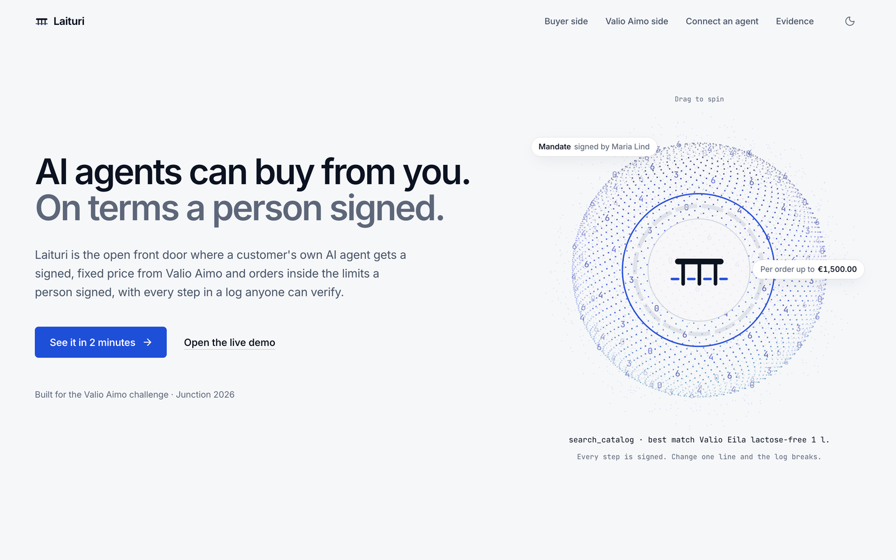
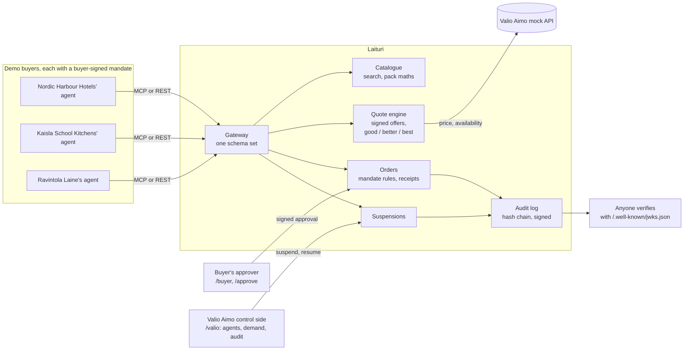

# Laituri

An open MCP and REST front door that lets a customer's own AI purchasing agent buy from Valio Aimo at a signed fixed price, inside limits a person signed, with a log anyone can verify.



Live: https://laituri.31-97-126-112.sslip.io

Built for the Valio Aimo challenge "Trusted Trade Agents" at Junction 2026. All data is the challenge's synthetic data. Orders are simulated; the full list of what is simulated, assumed or not built is in [Simulated, assumed and not built](#simulated-assumed-and-not-built).

## What it is

A restaurant, hotel or school kitchen lets its own AI agent order food from the wholesaler instead of a person clicking through the web shop. The agent gets a price the wholesaler has signed, and it may order alone only within limits the kitchen's purchasing lead signed; anything bigger or unusual waits for her approval. Both the kitchen and the wholesaler see the same record of what happened, and anyone can check that nobody changed it.

## See it in 2 minutes

- **Walkthrough.** Open the live demo and press "See it in 2 minutes", or go to `/buyer?tour=1`. It drives the running product: the milk request, the signed offer, the mandate, an order over the limit approved on a phone, a product short of stock, the wholesaler's view of agents and demand, and the log.
- **Three clicks.** `/buyer` (ask for milk; it confirms), `/valio/agents` (every connected agent, with a suspend switch), `/evidence` (each criterion with its proof).
- **Three commands.**

```bash
npm install
npm test          # unit and integration tests
npm run eval      # four eval suites on recorded data with a fixed clock
```

## How each judging criterion is met

<!-- BEGIN:evidence:numbers -->
Measured by `npm run evidence` (numbers in [`src/lib/evidence/facts.json`](src/lib/evidence/facts.json)):

- Unit and integration tests: 492/492 pass in 64 files.
- Eval suites (`npm run eval`, recorded data, fixed clock): Scenarios 24/24, Guardrails 22/22, Trust 16/16, Openness 8/8; 70/70 cases in all.
- 15 mandate rules, 7 MCP tools, 21 REST operations on 19 paths, 6 discovery documents, 3 signing keys.
- 3 demo buyers; 31 seeded requests (24 of them place an order); recorded answers for 255 products.
<!-- END:evidence:numbers -->

<!-- BEGIN:evidence:criteria -->
| Criterion (weight) | What we built (first items; all in docs/judging.md) | Where in the code | Evidence | Known limit |
|---|---|---|---|---|
| **Working end-to-end demo** (30%) | A request in plain words goes through search, a signed fixed-price offer, the mandate check and either an automatic order or a person's signed approval, over the same MCP and REST interface an outside agent uses.<br>• Buyer side (/buyer): the agent takes "1,000 litres of lactose-free milk by Monday", gets a signed offer, and the order confirms; 1,600 litres waits for the approver.<br>• Approval on a phone-sized page (/approve/{orderId}): the approver's decision is signed with the approver key.<br>• Wholesaler side (/valio): connected agents, demand, unmet requests and the same audit log. | [`src/lib/gateway/gateway.ts`](src/lib/gateway/gateway.ts)<br>[`src/lib/agent/purchase.ts`](src/lib/agent/purchase.ts)<br>[`src/lib/orders/place.ts`](src/lib/orders/place.ts)<br>[`src/lib/demo/scenarios.ts`](src/lib/demo/scenarios.ts) | Scenarios eval suite: 24/24 cases pass (bar >=90%)<br>An agent that knows only the text of /llms.txt, fetched over HTTP from a server started for the eval, runs the curl lines of its REST flow in order (URLs, headers and bodies as written, filling each <field from step N> from that step's answer), searches, quotes and orders the milk, and the order confirms (eval O8)<br>Check: `/buyer?tour=1` on the live demo; `npm run eval -- --suite scenarios`; eval O8; `npx tsx scripts/buyer-agent.ts "1,000 litres of lactose-free milk by Monday"` | Orders are simulated: the mock API has price and availability but no order endpoint, so Laituri writes the order and receipt itself and marks each one simulated: true. |
| **Solving the problem and user need** (20%) | The agent orders what the buyer asked for: the wholesaler turns litres and kilograms into whole sales units, compares the buyer's words with every offer and signs that comparison into it, and an order that does not meet the words in full is never confirmed alone.<br>• Search reads Finnish, Swedish or English needs as a product concept plus claims (for example lactose_free) and returns a match confidence.<br>• Pack maths: 1,000 l becomes 1,000 x 1 l; the scenario evals accept at most one lot more than asked.<br>• Request check: product, every claim, words not understood, quantity (at most one lot over), date, a budget ("under 50 euros", "alle 50 euroa") and an order to wait ("ask me first", "älä tilaa ennen kuin hyväksyn"), each met, unmet or unchecked, signed inside the offer and shown on the order. | [`src/lib/catalog/search.ts`](src/lib/catalog/search.ts)<br>[`src/lib/offers/packs.ts`](src/lib/offers/packs.ts)<br>[`src/lib/request/index.ts`](src/lib/request/index.ts)<br>[`src/lib/gateway/confidence.ts`](src/lib/gateway/confidence.ts) | 24/24 scenario cases end on the expected route with the expected concept, amount and date<br>3 demo buyers, 31 seeded requests played through the real gateway<br>Check: eval 2; eval 12; eval 19; eval 22; `tests/request/fidelity.test.ts`; `tests/demo/two-kitchens.test.ts`; `tests/offers/packs.test.ts` | The product concepts and category groups are our own, built from the product data. The catalogue sells "lactose-free milk" as "lactose-free milk drink"; Laituri treats the two as one request and names the product it chose. |
| **Autonomy and controls** (20%) | A buyer-signed mandate sets what the agent may do alone, what waits for a named person and what is never allowed, and every decision is a signed entry in a hash-chained log that both sides verify with public keys.<br>• 15 named mandate rules run on every order; each result (pass, ask or block) is listed on the order with its reason.<br>• Three tiers: the agent orders alone, a person is asked, or the order is refused.<br>• Approvals are signed with the approver key. Agent credentials cannot approve, over REST or MCP. | [`src/lib/policy/evaluate.ts`](src/lib/policy/evaluate.ts)<br>[`src/lib/policy/rules`](src/lib/policy/rules)<br>[`src/lib/mandate/index.ts`](src/lib/mandate/index.ts)<br>[`src/lib/orders/approval.ts`](src/lib/orders/approval.ts) | Guardrails eval suite: 22/22 cases pass (bar 100%)<br>Trust eval suite: 16/16 cases pass (bar 100%)<br>15 mandate rules, 3 signing keys (supplier, buyer, approver)<br>Check: `npm run eval -- --suite guardrails`; eval G10; eval G5; `/buyer/mandate` on the live demo; `tests/gateway/suspension.test.ts` | In the demo one server holds all three private keys, and the approver signs in with a passcode or one-click demo access that the audit log labels as such. |
| **Robustness to exception situations** (15%) | When a request cannot be met in full and on time, the wholesaler returns signed counter-offers ranked good, better and best, and the buyer's mandate decides whether the agent may take one alone.<br>• Short stock: a split (keep what is in stock, fill the rest like for like) or a full substitute, each signed.<br>• Order cut-off passed: the offer as asked is blocked and on-time alternatives come with it.<br>• Late delivery within the mandate's grace days asks a person; later is refused. | [`src/lib/offers/alternatives.ts`](src/lib/offers/alternatives.ts)<br>[`src/lib/offers/substitutes.ts`](src/lib/offers/substitutes.ts)<br>[`src/lib/policy/rules/fulfilment.ts`](src/lib/policy/rules/fulfilment.ts)<br>[`src/lib/orders/lock.ts`](src/lib/orders/lock.ts) | Scenarios eval suite: 24/24 cases pass (bar >=90%)<br>Guardrails eval suite: 22/22 cases pass (bar 100%)<br>Check: eval 5; eval 6; eval 13; eval G20; eval G14 | Substitutes are chosen like for like within the wholesaler's own concept and category, not through recipe logic. |
| **Openness and credible path toward production** (15%) | One set of zod schemas produces the MCP tools, the REST routes and the OpenAPI 3.1 document; signatures are JWS with keys published as JWKS; assumptions, decisions and next steps are written down.<br>• 7 MCP tools and 21 REST operations on 19 paths, from one schema set.<br>• 6 discovery documents: OpenAPI is served beside the JWKS, agent card, AI catalog, UCP profile, OAuth protected-resource metadata and llms.txt.<br>• An outside agent that knows only the text of llms.txt, fetched over HTTP, buys the milk by following its REST flow. | [`src/lib/contracts`](src/lib/contracts)<br>[`src/lib/mcp/tools.ts`](src/lib/mcp/tools.ts)<br>[`src/lib/openapi/registry.ts`](src/lib/openapi/registry.ts)<br>[`src/lib/discovery`](src/lib/discovery) | Openness eval suite: 8/8 cases pass (bar 100%)<br>Unit and integration tests: 492/492 pass in 64 files<br>Check: `npm run eval -- --suite openness`; `/api/v1/openapi.json` on the live demo; `/.well-known/jwks.json` on the live demo; `/llms.txt` on the live demo | Agents use demo bearer tokens, not OAuth 2.1. AP2, UCP and Peppol are followed in names and shapes; no Peppol UBL document is produced. |
<!-- END:evidence:criteria -->

The same map in long form, with the core requirements, the optional directions and the brief's four problems, is in [docs/judging.md](docs/judging.md) and on `/evidence` (machine-readable at `/evidence.json`).

## What makes it different

- **The wholesaler has a control side.** `/valio` lists every agent that has called, the application it ran in, its calls, quotes and orders. One switch suspends an agent; every call it then makes is refused and logged. The demand view shows what agents asked for and could not get, with the reason (short stock, passed cut-off, not in the catalogue).
- **Same sentence, two kitchens.** The same request, sent by a hotel's agent and a school kitchen's agent, gets the same kind of signed offer. The hotel's order confirms; the school kitchen's is blocked because its mandate excludes sesame even as a trace. Only the mandates differ ([`tests/demo/two-kitchens.test.ts`](tests/demo/two-kitchens.test.ts)).
- **Proof that the offer equals the request.** The wholesaler compares the buyer's words with every offer before signing it: product, claims, quantity, date, a budget and an order to wait, each met, not met or not checked. The comparison is signed inside the offer, and each order shows it beside the buyer's words ([`src/lib/request/index.ts`](src/lib/request/index.ts), [`src/components/order/RequestProof.tsx`](src/components/order/RequestProof.tsx)).
- **Exceptions are signed counter-offers.** When stock is short, a cut-off has passed or delivery would be late, the wholesaler signs alternatives ranked good, better and best, each with the tier's meaning and the trade-off in one sentence ([`src/lib/offers/alternatives.ts`](src/lib/offers/alternatives.ts)).
- **A tamper-evident log, verified in the browser.** Both sides re-check the hash chain and every signature with the published keys in the browser. A visitor can alter one stored entry and watch the log name it ([`src/lib/console/verify.ts`](src/lib/console/verify.ts), [`src/lib/demo/tamper.ts`](src/lib/demo/tamper.ts)).
- **Product facts inside the signature.** Country of origin, labels, delivery reliability and the category-average CO2 are part of each signed offer line, so changing one breaks the signature (eval T14).

## What stays private

The brief asks for this "without exposing real systems, confidential data or the marketplace roadmap".

<!-- BEGIN:evidence:privacy -->
| Not exposed | Status | Answer | Where | Check |
|---|---|---|---|---|
| Real systems | Covered | The upstream API key and address stay on the server. Agents call Laituri's own routes; upstream answers are normalised into Laituri's contracts before anything is returned. | [`src/lib/valio/http.ts`](src/lib/valio/http.ts)<br>[`src/lib/valio/normalise.ts`](src/lib/valio/normalise.ts) | `/api/v1/openapi.json` on the live demo |
| Confidential data | Partly | Agents receive only the fields defined in the published schemas; the MCP server parses every tool result against its output schema, which drops any other field, and a result that does not parse is withheld and answered as a tool error. For an agent token, orders, offers, the mandate and approvals are scoped to its own buyer. The audit log is one public chain whose entries carry summaries with other buyers' products, quantities and prices (see Public audit log under Simulated, assumed and not built). | [`src/lib/contracts`](src/lib/contracts)<br>[`src/lib/mcp/server.ts`](src/lib/mcp/server.ts)<br>[`src/lib/http/buyer-scope.ts`](src/lib/http/buyer-scope.ts)<br>[`src/app/api/v1/offers/[id]/route.ts`](src/app/api/v1/offers/%5Bid%5D/route.ts) | eval O6; eval G21; `tests/buyers/isolation.test.ts`; `tests/mcp/output-validation.test.ts` |
| The buyer's terms | Covered | The wholesaler's overview counts which mandate rule held or stopped an order and its tier, never the limits or values behind it. | [`src/lib/insights/rules.ts`](src/lib/insights/rules.ts)<br>[`src/lib/contracts/supplier.ts`](src/lib/contracts/supplier.ts) | `tests/insights/insights.test.ts` |
| The marketplace roadmap | Covered | Nothing in the interface depends on a marketplace: it exposes today's catalogue, price, availability and ordering only. All data is the challenge's synthetic data. | [`src/lib/openapi/registry.ts`](src/lib/openapi/registry.ts)<br>[`fixtures/upstream`](fixtures/upstream) | `/api/v1/openapi.json` on the live demo |
<!-- END:evidence:privacy -->

No production data is involved: every product, price, buyer and order is synthetic.

## Trust protocol

The minimum an agent needs to trust price, stock, delivery date, origin and labels without a manual check:

1. **Published keys.** Fetch `/.well-known/jwks.json`. Each key has a `role`: `supplier` signs offers, receipts and audit entries; `buyer` signs mandates; `approver` signs approvals.
2. **A signed offer.** `request_quote` (or `POST /api/v1/quotes`) returns `primary.jws`: a compact JWS, ES256, `typ: offer+jwt`. Its payload holds the fixed unit price, line totals, available units, delivery date, order cut-off (`orderBy`), the product facts, `issuedAt` and `expiresAt`.
3. **Verify before trusting.** Check the signature with the supplier key named by `kid`. Check that `expiresAt` and `orderBy` are in the future.
4. **Order with the offer unchanged.** `place_order` re-verifies it. One changed byte blocks the order (evals G1, G2, T7, T14). One offer gives one order (G9). The offer expires after 15 minutes.
5. **Keep the receipt.** A confirmed order returns `receiptJws` (`typ: receipt+jwt`), bound to the offer by its hash and to its audit entry by sequence number (T5).
6. **Check the log later.** `GET /api/v1/audit/verify` re-checks the chain and every signature; `GET /api/v1/audit/checkpoint` returns a signed head to keep and compare (T6, T12).

Details and failure cases: [docs/trust-protocol.md](docs/trust-protocol.md).

## How it works



1. **Search.** The catalogue reads "lactose-free milk" as a concept plus claims, ranks products, does the pack maths (1,000 l = 1,000 x 1 l) and states its match confidence.
2. **Quote.** Live price and availability become an offer signed by the wholesaler key. When the request cannot be met in full and on time, signed alternatives come with it.
3. **Order.** The agent sends the offer and its mandate, both unchanged. Every mandate rule runs and is listed on the order with its result.
4. **Approve.** An order in the "ask" tier waits for the buyer's named approver, who decides on `/buyer` or on the phone page `/approve/{orderId}`. The decision is signed with the approver key. Approving checks the order again against the mandate in force; a "never" rule, an expired mandate or a used offer stops it.
5. **Control.** The wholesaler watches agents and demand on `/valio` and can suspend an agent.
6. **Prove.** Each step appends a signed entry to a hash chain, which both sides re-check in the browser.

Components, key custody and sequence diagrams: [docs/architecture.md](docs/architecture.md).

## Connect an agent

Point any MCP client at `https://<host>/mcp` (Streamable HTTP), or read `/llms.txt` and use plain HTTP. The bearer token `demo-agent-token` identifies the hotel's agent; `demo-kaisla-token` and `demo-laine-token` identify the other two demo buyers' agents. `/connect` has set-up lines for common agent applications.

<!-- BEGIN:evidence:tools -->
| Tool (MCP) | REST | Purpose |
|---|---|---|
| `search_catalog` | `POST /api/v1/products/search` | Search the wholesaler catalogue |
| `get_product` | `GET /api/v1/products/{id}` | Read one product |
| `request_quote` | `POST /api/v1/quotes` | Get a signed fixed-price offer |
| `get_mandate` | `GET /api/v1/mandate` | Read your purchasing mandate |
| `place_order` | `POST /api/v1/orders` | Place an order from a signed offer |
| `get_order` | `GET /api/v1/orders/{id}` | Check an order's status |
| `verify_audit` | `GET /api/v1/audit/verify` | Verify the audit trail |
<!-- END:evidence:tools -->

Discovery: `/api/v1/openapi.json`, `/.well-known/jwks.json`, `/.well-known/agent-card.json`, `/.well-known/ai-catalog.json`, `/.well-known/ucp`, `/.well-known/oauth-protected-resource`, `/llms.txt`.

## Eval results

<!-- BEGIN:evidence:evals -->
| Suite | Passed | Bar | Result | What it proves |
|---|---|---|---|---|
| Scenarios (`scenarios`) | 24/24 | >=90% | met | Plain-language requests end on the right route (auto, approval, blocked, no order) with the right product, amount and date, and a verified audit trail. |
| Guardrails (`guardrails`) | 22/22 | 100% | met | Edited, expired, replayed or wrongly signed inputs, forged approvals, injected instructions and races never get past the mandate. |
| Trust (`trust`) | 16/16 | 100% | met | Every signature verifies with the published keys, and any changed, deleted, reordered or cut entry is detected. |
| Openness (`openness`) | 8/8 | 100% | met | The OpenAPI document and MCP tools are complete and callable, discovery documents are served, and an agent that reads llms.txt over HTTP buys by following its REST flow. |

Unit and integration tests: 492/492 pass in 64 files (`npm test`).
<!-- END:evidence:evals -->

Reproduce: `npm run eval` (writes `evals/report.json`; the recorded run uses a fixed clock, so an unchanged result writes an unchanged file). `npm run eval -- --live` runs a smoke subset against the live mock API. Every case and what it proves: [docs/evals.md](docs/evals.md).

## Quickstart

```bash
cp .env.example .env      # add VALIO_API_KEY for live prices
npm install
npm run setup             # downloads the product data once and builds the search index
npm run dev               # http://localhost:3210
```

No key? `VALIO_MODE=recorded npm run dev` replays recorded price and availability answers.

| Command | What it does |
|---|---|
| `npm run dev` | Landing page at `/`, buyer side at `/buyer`, wholesaler side at `/valio`, REST at `/api/v1`, MCP at `/mcp` |
| `npm test` | Unit and integration tests |
| `npm run eval` | The four eval suites, on recorded data with a fixed clock |
| `npm run evidence` | Runs the evals and tests, writes `src/lib/evidence/facts.json` and regenerates the numbered blocks in this README and `docs/` |
| `npm run typecheck`, `npm run lint` | TypeScript and ESLint |
| `npx tsx scripts/buyer-agent.ts "1,000 litres of lactose-free milk by Monday"` | An outside process buys over HTTP from a running server |

## The mandate: allowed, ask, never

| Rule | Ask a person | Never |
|---|---|---|
| Spend per order, per week | Over the limit | |
| Category | Outside the allowed list | |
| Allergens, required claims | Food with no allergen declaration | Excluded allergen (also as a trace when the mandate says so), missing allergen data, missing claim |
| Substitution | Not like for like, or price up more than the cap | Any substitute when the policy says none |
| Partial delivery, late delivery | Partial not allowed; late within the grace days | Later than the grace days |
| Request match, first-time product | Low confidence; a requirement in the buyer's words not met or not checkable (budget, date, an order to wait, words not understood); first order of a product when the mandate asks for it | The offer certainly fails the words: wrong product, a missing claim, less than half the need asked for |
| Signatures, validity, expiry | | Invalid, replaced or expired mandate; altered, expired or already used offer; wrong agent; cut-off passed |

The three demo mandates differ in kind: the hotel has the largest limits; the school kitchens exclude peanut, nuts and sesame even as traces and accept no late delivery; the restaurant takes no substitutes and its owner approves every first-time product ([`src/lib/mandate/defaults.ts`](src/lib/mandate/defaults.ts)).

An agent cannot raise its own limit, change a price or approve its own order. Each attempt is refused and written to the audit log.

## Standards used

"Used" means implemented and tested here. "Follows" means the names, shapes or codes are taken from the standard so a later full implementation does not change the interface.

| Area | Choice |
|---|---|
| Agent interface | Used: Model Context Protocol (Streamable HTTP) and REST described by OpenAPI 3.1 |
| Signatures | Used: JWS compact, ES256, keys published as JWKS (RFC 7515, 7517, 7638) |
| Mandate | Follows AP2 (Agent Payments Protocol): a signed JWT shaped like its Open Checkout Mandate (`vct`, `constraints[]`, `exp`) |
| Commerce vocabulary | Follows UCP (Universal Commerce Protocol) terms for catalogue, checkout and order, including escalation to a person |
| Order response | Follows Peppol BIS Ordering: the signed receipt carries its response code (AP accepted, CA accepted with change, RE rejected). No UBL document is produced yet |
| Identifiers | Used: GS1 GTIN for products. Follows: OVT (Finnish e-invoice address) and GLN (GS1 location number) for parties |
| Errors | Used: RFC 9457 problem details |
| Discovery | Used: agent card, AI catalog, `llms.txt`, OAuth protected-resource metadata |

## Scope note

The brief says that whether Valio Aimo's production interface becomes a traditional API, an MCP-style agentic interface or a service agent of its own is outside the challenge's scope. Laituri does not choose: the MCP tools, the REST routes and the OpenAPI document are generated from one set of zod schemas in [`src/lib/contracts`](src/lib/contracts), behind one gateway ([`src/lib/gateway`](src/lib/gateway)). A service agent of Valio Aimo's own would be one more client of the same gateway. What we mock is the order entry: the challenge's API has price and availability only, so Laituri writes the order and receipt itself ([docs/decisions/0001-mcp-and-rest-from-one-schema-set.md](docs/decisions/0001-mcp-and-rest-from-one-schema-set.md)).

## Scenario coverage

<!-- BEGIN:evidence:scenarios -->
| Example scenario in the brief | Status | What exists | Where |
|---|---|---|---|
| Need → recipe → order | Not built | No recipe model and no kitchen stock data. The ordering step at the end is what Laituri provides. | None |
| Last-minute event | Partly | "By tomorrow" requests, passed order cut-offs and late dates are flagged with signed on-time alternatives. No recipe logic: alternatives are like for like. | [`src/lib/policy/rules/fulfilment.ts`](src/lib/policy/rules/fulfilment.ts), [`src/lib/offers/alternatives.ts`](src/lib/offers/alternatives.ts), eval 6, eval 13 |
| Supplier stock-out | Partly | Short stock returns a signed split or substitute with a one-sentence trade-off. It answers at quote time, not before the kitchen asks, and substitutes are like for like rather than recipe-compatible. | [`src/lib/offers/alternatives.ts`](src/lib/offers/alternatives.ts), eval 5 |
| Proactive selling agent | Not built | The wholesaler side shows unmet demand (what agents asked for and could not get), which such an agent would start from. Nothing is pushed to buyers' agents. | [`src/lib/insights/requests.ts`](src/lib/insights/requests.ts), [`src/app/valio/demand/page.tsx`](src/app/valio/demand/page.tsx), `/valio/demand` on the live demo |
| Allergen-safe substitution under pressure | Partly | The school kitchens' mandate excludes peanut, nuts and sesame, also as traces, and every line, substitutes included, is checked. Missing allergen data blocks the line. Nutrition rules are not modelled. | [`src/lib/policy/rules/products.ts`](src/lib/policy/rules/products.ts), [`src/lib/mandate/defaults.ts`](src/lib/mandate/defaults.ts), eval 9b, `tests/demo/two-kitchens.test.ts` |
| Standing order drift detection | Not built | No standing orders. The nearest control is the weekly spend limit and the rule that sends a first-time product to a person. | [`src/lib/policy/rules/spend.ts`](src/lib/policy/rules/spend.ts), eval 14, eval 18 |
<!-- END:evidence:scenarios -->

## Simulated, assumed and not built

<!-- BEGIN:evidence:simulated -->
Simulated or assumed:

- **Orders.** Orders are simulated. The mock API has price and availability but no order endpoint, so Laituri creates the order, the receipt and the log entry itself and marks every order simulated: true. ([`src/lib/orders/confirm.ts`](src/lib/orders/confirm.ts))
- **Keys.** One server holds all three private keys (buyer, supplier, approver) in .data/keys, so one deployment plays all three parties. In production each party keeps its own key. ([`src/lib/trust/keys.ts`](src/lib/trust/keys.ts))
- **Agent identity.** Agents use demo bearer tokens, one per demo buyer (demo-agent-token, demo-kaisla-token, demo-laine-token), instead of OAuth 2.1. The OAuth protected-resource metadata is already published. ([`src/lib/http/agent.ts`](src/lib/http/agent.ts), [`src/app/.well-known/oauth-protected-resource/route.ts`](src/app/.well-known/oauth-protected-resource/route.ts))
- **Demo buyers.** 3 demo buyers (Nordic Harbour Hotels, Kaisla School Kitchens, Ravintola Laine) trade under the mock API's one customer number; the signed buyer id keeps them apart. ([`src/lib/mandate/defaults.ts`](src/lib/mandate/defaults.ts))
- **Seeded history.** On an empty state the server plays 31 requests by the demo buyers over about a week through the real gateway, at past times. Every offer, order, approval and audit entry is signed and chained as in live use, and marked seeded. LAITURI_SEED=off turns it off. ([`src/lib/seed/plan.ts`](src/lib/seed/plan.ts), [`src/lib/seed/index.ts`](src/lib/seed/index.ts))
- **Demo access.** One click signs a visitor in as the hotel's approver without the passcode; each approval or mandate change made that way says "demo access" in the audit log. LAITURI_DEMO_ACCESS=off disables it. ([`src/lib/http/console-session.ts`](src/lib/http/console-session.ts))
- **Open reading.** Orders, approvals, the mandate and the audit log can be read without signing in, so anyone can watch. They hold synthetic data only. Production puts every read behind each party's own access control. ([`src/lib/http/buyer-scope.ts`](src/lib/http/buyer-scope.ts))
- **Demo controls.** Starting a scene, altering one log entry to show detection and suspending an agent are open to visitors and refuse agent credentials; reset needs the approver. The altered entry is put back after five minutes. A production deployment has none of these controls open. ([`src/lib/demo/tamper.ts`](src/lib/demo/tamper.ts), [`src/app/api/v1/demo/reset/route.ts`](src/app/api/v1/demo/reset/route.ts))
- **State.** State is kept in memory with a JSON snapshot on disk. An order, an approval, a mandate change, a suspension and each audit entry are written to disk (temporary file, fsync, rename) before the call returns, and a failed write fails the call. Offers, activity and demand records are saved a moment later. An unreadable snapshot is kept aside under a new name and reported by /api/v1/health, and the service starts empty. One process serialises order decisions, so two orders cannot pass a limit together. ([`src/lib/store/memory.ts`](src/lib/store/memory.ts), [`src/lib/store/snapshot.ts`](src/lib/store/snapshot.ts), [`src/lib/orders/lock.ts`](src/lib/orders/lock.ts))
- **Recorded mode.** Without an API key, recorded price and availability answers for 255 products replay with a fixed clock. Tests and evals always use this mode. ([`src/lib/valio/recorded.ts`](src/lib/valio/recorded.ts), [`fixtures/upstream`](fixtures/upstream))
- **Product concepts.** Category groups and the product concept list are our own, built from the product data. "Lactose-free milk" is sold as "lactose-free milk drink"; Laituri treats them as one request and shows the product name it chose. ([`src/lib/catalog/build/groups.ts`](src/lib/catalog/build/groups.ts), [`src/lib/catalog/lexicon.ts`](src/lib/catalog/lexicon.ts))
- **Upstream data.** A closingTime in the past means that delivery date can no longer be ordered. An available amount of 9999999999 or 999999 means no tracked limit. Availability returns the next delivery date whatever date is asked; Laituri compares it with the requested date. ([`src/lib/valio/normalise.ts`](src/lib/valio/normalise.ts))
- **Pack contents.** Litres or kilograms per sales unit come from the product's unit data, else from the price divided by the comparison price. ([`src/lib/offers/packs.ts`](src/lib/offers/packs.ts))
- **Carbon figure.** The CO2 figure is the average for the product's category (categoryAverageCo2PerKg), not a measurement of the product. ([`src/lib/contracts/facts.ts`](src/lib/contracts/facts.ts))
- **Request check.** The wholesaler compares the buyer's words, sent as the quote's intent, with every offer before it signs it: the product, every claim, words it does not understand, the quantity (covers the need, at most one lot over), the date, a budget and an order to wait for a person. Each is met, unmet or unchecked and is signed inside the offer. An order is confirmed alone only when all are met; a certain mismatch (wrong product, a missing claim, less than half the need asked for) blocks it, and anything else waits for the approver with the requirement named. The agent's stated match confidence never counts for more than the wholesaler finds. What the goods are for ("for the breakfast buffets") is kept as context and not checked. An agent that sends no words gets no request check, and its order can still be confirmed alone inside the mandate. ([`src/lib/request/index.ts`](src/lib/request/index.ts), [`src/lib/request/requirements.ts`](src/lib/request/requirements.ts), [`src/lib/policy/rules/products.ts`](src/lib/policy/rules/products.ts), [`src/lib/gateway/confidence.ts`](src/lib/gateway/confidence.ts))
- **Approver judgement.** An approval re-checks the order against the mandate in force at that moment. What the ask tier flagged, such as a weekly limit or a category the mandate no longer lists, is the approver's to decide, so an approver can approve several waiting orders that together pass the weekly limit; each order shows the limit it passed. A never-tier rule, an invalid or expired mandate, or an offer that expired or was used stops the approval, and the order is blocked with a signed audit entry. ([`src/lib/orders/approval.ts`](src/lib/orders/approval.ts), [`src/lib/orders/recheck.ts`](src/lib/orders/recheck.ts))
- **Audit completeness.** Verification proves that entries were not changed, reordered or removed from the middle. A verifier that remembers a head (size and hash) checks that the entry at that size still carries that hash in any later log, so a log that was cut, cut and extended, or rewritten from an earlier entry is detected whatever its length. The service will not append onto a tail that fails its hash, link, signature or remembered head. While the log does not verify, approvals are paused. ([`src/lib/audit/verify.ts`](src/lib/audit/verify.ts), [`src/lib/audit/tail.ts`](src/lib/audit/tail.ts), [`src/lib/audit/chain.ts`](src/lib/audit/chain.ts), [`src/lib/audit/head.ts`](src/lib/audit/head.ts), [`src/lib/gateway/gateway.ts`](src/lib/gateway/gateway.ts))
- **Public audit log.** The audit log is one public chain, so anyone can verify all of it: every reader, with any token or none, reads every buyer's entries. Each entry names its buyer and carries a one-sentence summary and structured data: what was searched for, the products and quantities offered and ordered, offer and order totals in euros, delivery dates, the mandate checks that held or stopped an order with their messages (which can quote a buyer's limit), and each mandate change. Between buyers that is commercially sensitive. Production keeps the one chain but gives each buyer only its own entries, each with an inclusion proof against a signed checkpoint, and keeps summaries free of prices and quantities. ([`src/app/api/v1/audit/route.ts`](src/app/api/v1/audit/route.ts), [`src/lib/orders/summaries.ts`](src/lib/orders/summaries.ts), [`src/lib/gateway/describe.ts`](src/lib/gateway/describe.ts))
- **Buyer agent.** The fixed demo scenes, the tests and the evals use a scripted buyer agent, so results repeat. Free-text requests use Claude or Gemini when a key is set, else the scripted agent. ([`src/lib/agent/purchase.ts`](src/lib/agent/purchase.ts), [`src/lib/agent/llm/engine.ts`](src/lib/agent/llm/engine.ts))
- **Voice.** Spoken input uses the browser's Web Speech API. Spoken answers use the browser's voice, or ElevenLabs when a key is set on the server. ([`src/lib/voice/speech-to-text.ts`](src/lib/voice/speech-to-text.ts), [`src/lib/voice/text-to-speech.ts`](src/lib/voice/text-to-speech.ts))

Not built:

- **Recipes.** No recipe model: substitutes are like for like, not recipe-compatible.
- **Kitchen stock.** The agent does not read the kitchen's own stock or ERP.
- **Proactive selling.** No wholesaler agent that pushes products to buyers' agents.
- **Standing orders.** No recurring orders and no drift detection.
- **Payments.** No agentic payment (x402 or similar); orders follow the buyer's existing account terms.
- **Peppol documents.** The receipt carries Peppol order-response codes, but no UBL document is produced.
- **Nutrition rules.** Allergens and claims are checked; nutrition values are not.
<!-- END:evidence:simulated -->

## From demo to production

<!-- BEGIN:evidence:production -->
1. **Real order entry.** Replace the simulated order with the ERP's order entry and return its order number in the signed receipt. Builds on [`src/lib/orders/confirm.ts`](src/lib/orders/confirm.ts).
2. **OAuth 2.1 per agent.** Scoped tokens (catalog:read, quote:create, order:place) in place of demo tokens. The scopes are already declared in the OpenAPI document and the protected-resource metadata. Builds on [`src/lib/discovery/documents.ts`](src/lib/discovery/documents.ts), [`src/lib/openapi/registry.ts`](src/lib/openapi/registry.ts).
3. **Key custody per party.** The wholesaler runs Laituri with the supplier key only; the buyer signs mandates in its own system; the approver signs with a personal credential. Builds on [`src/lib/trust/keys.ts`](src/lib/trust/keys.ts).
4. **Buyer identity.** A verifiable organisation credential (the planned EU Business Wallet) instead of a demo key.
5. **Mandate copy at the wholesaler.** Keep the signed mandate in the customer master as well, so both sides hold the same signed copy. Builds on [`src/lib/mandate/index.ts`](src/lib/mandate/index.ts).
6. **Database.** Transactions and row locks in place of the single-process store. Builds on [`src/lib/store/types.ts`](src/lib/store/types.ts).
7. **External audit anchor.** Anchor audit checkpoints in an external transparency service (SCITT), so completeness no longer depends on the verifier's memory. Builds on [`src/lib/audit/checkpoint.ts`](src/lib/audit/checkpoint.ts).
8. **Peppol ordering.** Order and order-response documents for customers that already trade over Peppol; the response codes are already in the receipt. Builds on [`src/lib/orders/receipt.ts`](src/lib/orders/receipt.ts).
<!-- END:evidence:production -->

Design decisions and their trade-offs: [docs/decisions](docs/decisions).

## Layout

```
src/lib/contracts       zod schemas: the single source for REST, MCP and the screens
src/lib/valio           upstream client (live and recorded)
src/lib/catalog         index, concept lexicon, search, substitutes
src/lib/offers          quote engine, pack maths, product facts, good/better/best alternatives
src/lib/orders          placement, approvals, receipts
src/lib/policy          the mandate rules
src/lib/mandate         the demo buyers' signed mandates
src/lib/trust           keys, JWS, JWKS
src/lib/audit           hash chain, verification, checkpoint
src/lib/gateway         one facade behind REST, MCP and the screens; agent suspension
src/lib/insights        the wholesaler's overview: agents, demand, unmet requests, fired rules
src/lib/seed            about a week of demo history, played through the real gateway
src/lib/agent           the scripted buyer agent, and model-driven agents (Claude, Gemini) in agent/llm
src/lib/voice           speech input and output adapters
src/lib/evidence        the criteria-to-evidence source behind this README, docs/ and /evidence
src/app                 landing, /buyer, /valio, /connect, /approve, /evidence, REST routes, MCP, discovery
evals                   scenario, guardrail, trust and openness suites
docs                    architecture, evals, trust protocol, judging map, decision records
```

## Licence

MIT. See [LICENSE](LICENSE).
