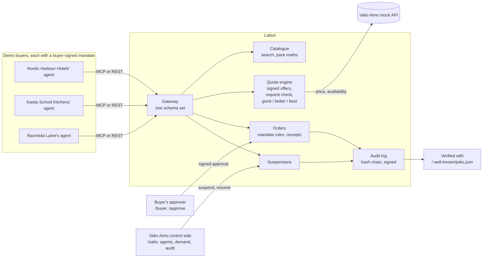
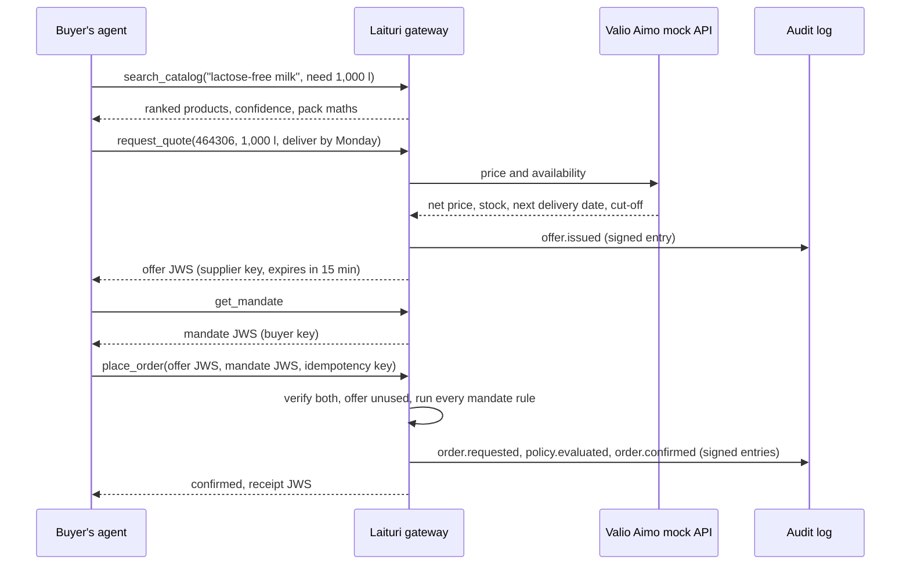
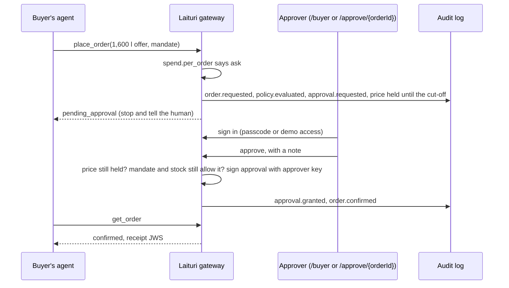
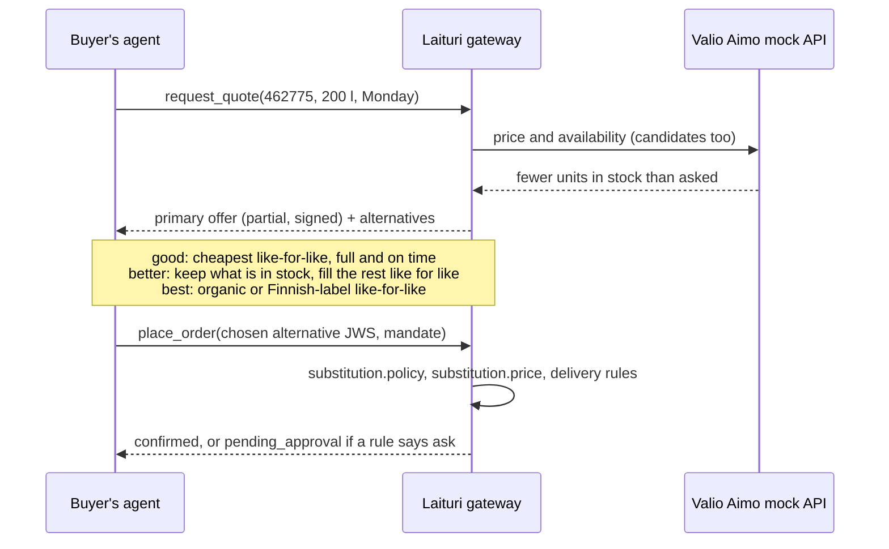
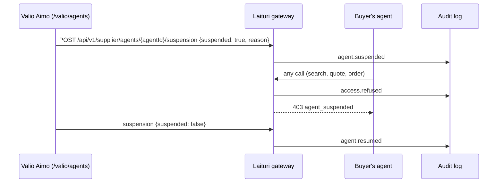

# Architecture

Laituri is one Next.js application. It plays three parties in the demo: the buyer (a kitchen and its approver), the wholesaler (Valio Aimo) and the agent's front door between them. Every agent call, from MCP, REST or the screens, goes through one gateway.

## How it works



1. **Search.** The catalogue reads "lactose-free milk" as a concept plus claims, ranks products, does the pack maths (1,000 l = 1,000 x 1 l) and states its match confidence.
2. **Quote.** Live price and availability, less this workspace's own confirmed and waiting orders, become an offer signed by the wholesaler key. The wholesaler compares the buyer's words with the product each line delivers and signs that check into the offer. When the request cannot be met in full and on time, signed alternatives come with it, each checked the same way.
3. **Order.** The agent sends the offer and its mandate, both unchanged and both bound to this workspace. Every mandate rule runs and is listed on the order with its result.
4. **Approve.** An order in the "ask" tier waits for the buyer's named approver. The wholesaler signs and logs that it holds the price until the order cut-off. The approver decides on `/buyer` or on the phone page `/approve/{orderId}`; the decision is signed with the approver key. Approving checks the order again against the mandate in force and the stock; a "never" rule, an expired mandate, a used offer or a shortfall stops it.
5. **Control.** The wholesaler watches agents and demand on `/valio` and can suspend an agent.
6. **Prove.** Each step appends a signed entry to a hash chain, which both sides re-check in the browser.

## Components

| Component | Path | What it does |
|---|---|---|
| Contracts | [`src/lib/contracts`](../src/lib/contracts) | zod schemas for every request and response. The OpenAPI document, the MCP tool schemas and the screens use them. |
| Gateway | [`src/lib/gateway`](../src/lib/gateway) | One facade: search, quote, mandate, order, approval, audit, suspension, supplier overview. Admits or refuses each agent call. |
| REST | [`src/app/api/v1`](../src/app/api/v1) | Route handlers. Each reads its body with a contract and calls the gateway. Errors are RFC 9457 problem details ([`src/lib/http/respond.ts`](../src/lib/http/respond.ts)). |
| MCP | [`src/lib/mcp`](../src/lib/mcp), [`src/app/mcp/route.ts`](../src/app/mcp/route.ts) | Streamable HTTP server. Each tool mirrors one REST operation; each result is parsed against its output schema. |
| OpenAPI | [`src/lib/openapi`](../src/lib/openapi) | The operation registry and the OpenAPI 3.1 document built from it. |
| Upstream client | [`src/lib/valio`](../src/lib/valio) | Calls the challenge's mock API (price, availability) with the server-side key, or replays recorded answers. Normalises upstream fields. |
| Catalogue | [`src/lib/catalog`](../src/lib/catalog) | Product index, concept lexicon (Finnish, Swedish, English), search and ranking, like-for-like candidates. |
| Offers | [`src/lib/offers`](../src/lib/offers) | Pack maths, offer lines with product facts, signed offers, good/better/best alternatives. |
| Policy | [`src/lib/policy`](../src/lib/policy) | The mandate rules. Pure: every input is passed in. |
| Mandate | [`src/lib/mandate`](../src/lib/mandate) | The demo buyers' terms, signed with the buyer key; reading and re-signing a changed mandate. |
| Orders | [`src/lib/orders`](../src/lib/orders) | Placement, idempotency, single use of offers, approval, signed receipts. One lock serialises decisions. |
| Audit | [`src/lib/audit`](../src/lib/audit) | Hash chain of signed entries, verification, signed checkpoints. |
| Trust | [`src/lib/trust`](../src/lib/trust) | Key generation and storage, JWS signing and verification, canonical JSON. |
| Insights | [`src/lib/insights`](../src/lib/insights) | The wholesaler's overview: connected agents, demand, unmet requests, offer conversion, fired rules. Pure. |
| Seed | [`src/lib/seed`](../src/lib/seed) | Plays about a week of demo requests through the real gateway at past times. |
| Agent | [`src/lib/agent`](../src/lib/agent) | The scripted buyer agent, and model-driven agents (Claude, Gemini) behind one adapter in `agent/llm`. |
| Screens | [`src/app`](../src/app), [`src/components`](../src/components) | Landing page, buyer side, wholesaler side, connect page, phone approval page, walkthrough, `/evidence`. |

## Data flow

1. An agent calls a tool or route with its bearer token: a key from `POST /api/v1/workspace` or from a browser's sandbox, or a fixed demo token for the shared demo workspace. [`src/lib/http/agent.ts`](../src/lib/http/agent.ts) maps the token to the agent and buyer named in that buyer's mandate.
2. The gateway refuses the call if the wholesaler has suspended the agent ([`src/lib/gateway/suspension.ts`](../src/lib/gateway/suspension.ts)), and records the call for the wholesaler's activity view.
3. Search reads the local index. A quote asks the upstream client for live price and availability, builds the lines and signs the offer with the supplier key.
4. An order carries the offer JWS and the mandate JWS. The order module verifies both, checks the offer has not been used, runs every policy rule and then confirms, waits for approval, or blocks.
5. Every step appends a signed entry to the audit chain. State lives in memory with a JSON snapshot in `.data/state.json`; orders, approvals, mandate changes and audit entries are on disk before their call returns ([`src/lib/store/memory.ts`](../src/lib/store/memory.ts)).
6. The screens poll the REST routes, fetch the JWKS and re-check the chain and signatures in the browser ([`src/lib/console/verify.ts`](../src/lib/console/verify.ts)).

## The three keys and their custody

| Key | Signs | Who holds it in production | Who holds it in the demo |
|---|---|---|---|
| Supplier | Offers, receipts, audit entries, checkpoints | The wholesaler; Laituri runs with this key only | This server, `.data/keys` |
| Buyer | Mandates | The buyer, in its own purchasing system | This server, `.data/keys` |
| Approver | Approvals, the approver's sign-in session | The buyer's approver, with a personal credential | This server, `.data/keys` |

All three public keys are published at `/.well-known/jwks.json` with their `role`. An agent holds no key: it cannot sign a mandate, an offer or an approval, so it cannot raise its limit, change a price or approve its own order.

## Sequence: automatic order



## Sequence: approval



An agent token cannot approve over REST, and no MCP tool approves (evals G10 to G13). The price is held until the order cut-off for the delivery date, never beyond it. If the hold ended before the approver answered, the order is rejected and the reason logged; if stock fell short, the order is blocked and fresh signed alternatives come back.

## Sequence: exception with alternatives



## Sequence: suspension



## What runs where

- Server: the REST routes, the MCP endpoint, the gateway and everything it calls.
- Browser: the screens (`src/components`, with `src/lib/console`, `src/lib/supplier-console` and `src/lib/tour`), chain and signature verification with the published keys, speech input (Web Speech API).
- At start-up, [`src/instrumentation.ts`](../src/instrumentation.ts) seeds demo history when the state is empty.

## Connect an agent

Create a private sandbox with `POST /api/v1/workspace`: it returns one agent key per demo buyer and the MCP address, and works from curl or any agent. Then point an MCP client at `https://<host>/mcp` (Streamable HTTP), or follow `/llms.txt` with plain HTTP. The fixed tokens `demo-agent-token`, `demo-kaisla-token` and `demo-laine-token` belong to the shared demo workspace that the evals use. `/connect` has set-up lines for common agent applications.

<!-- BEGIN:evidence:tools -->
| Tool (MCP) | REST | Purpose |
|---|---|---|
| `search_catalog` | `POST /api/v1/products/search` | Search the wholesaler catalogue |
| `get_product` | `GET /api/v1/products/{id}` | Read one product |
| `request_quote` | `POST /api/v1/quotes` | Get a signed fixed-price offer |
| `get_mandate` | `GET /api/v1/mandate` | Read your purchasing mandate |
| `place_order` | `POST /api/v1/orders` | Place an order from a signed offer |
| `place_basket` | `POST /api/v1/baskets` | Order a basket of many lines |
| `get_order` | `GET /api/v1/orders/{id}` | Check an order's status |
| `verify_audit` | `GET /api/v1/audit/verify` | Verify the audit trail |
| `plan_menu` | `POST /api/v1/menus/plan` | Plan a menu for an event |
| `list_recipes` | `GET /api/v1/recipes` | List the recipe library |
| `plan_event` | `POST /api/v1/assistant/turn` | Talk an event through to a menu and an order |
<!-- END:evidence:tools -->

Discovery: `/api/v1/openapi.json`, `/.well-known/jwks.json`, `/.well-known/agent-card.json`, `/.well-known/ai-catalog.json`, `/.well-known/ucp`, `/.well-known/oauth-protected-resource`, `/llms.txt`. For a reader rather than a client: `/llms-full.txt` (the paper and the agent guide in one file), `/paper` and `/paper.md`, `/evidence.json`, `/robots.txt` and `/sitemap.xml`.

## Layout

```
src/lib/contracts       zod schemas: the single source for REST, MCP and the screens
src/lib/valio           upstream client (live and recorded)
src/lib/catalog         index, concept lexicon, search, substitutes
src/lib/request         the buyer's words read and compared with each offer
src/lib/offers          quote engine, pack maths, product facts, good/better/best alternatives
src/lib/orders          placement, approvals, receipts
src/lib/basket          weekly and menu baskets: one signed offer and order per line, reasons, drift, safe swaps
src/lib/menu            event menus, scaling, shopping lists net of stock
src/lib/recipes         recipe library, Valio recipes, swaps by recipe role
src/lib/assistant       the event conversation that ends in menu cards and a basket
src/lib/handoffs        questions handed to a person at Valio Aimo
src/lib/suggestions     seasonal and event suggestions
src/lib/policy          the mandate rules
src/lib/mandate         the demo buyers' signed mandates
src/lib/trust           keys, JWS, JWKS
src/lib/audit           hash chain, verification, checkpoint
src/lib/gateway         one facade behind REST, MCP and the screens; agent suspension
src/lib/insights        the wholesaler's overview: agents, demand, unmet requests, fired rules
src/lib/workspace       the shared workspace and the per-visitor sandboxes
src/lib/seed            about a week of demo history, played through the real gateway
src/lib/agent           the scripted buyer agent, and model-driven agents (Claude, Gemini) in agent/llm
src/lib/voice           speech input and output adapters
src/lib/discovery       llms.txt, llms-full.txt, agent card, AI catalog, UCP profile, JWKS, the paper as text
src/lib/evidence        the criteria-to-evidence source behind the README, docs/, /evidence and /paper
src/app                 / (to /buyer), /about, /buyer, /valio, /security, /connect, /approve, /evidence, /paper, REST routes, MCP, discovery
evals                   scenario, guardrail, trust and openness suites
docs                    paper, architecture, evals, trust protocol, mandates, production path, judging map, decision records
```
