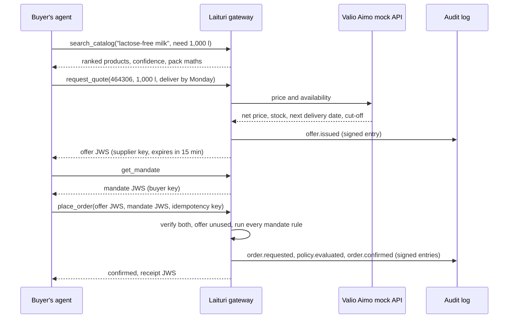
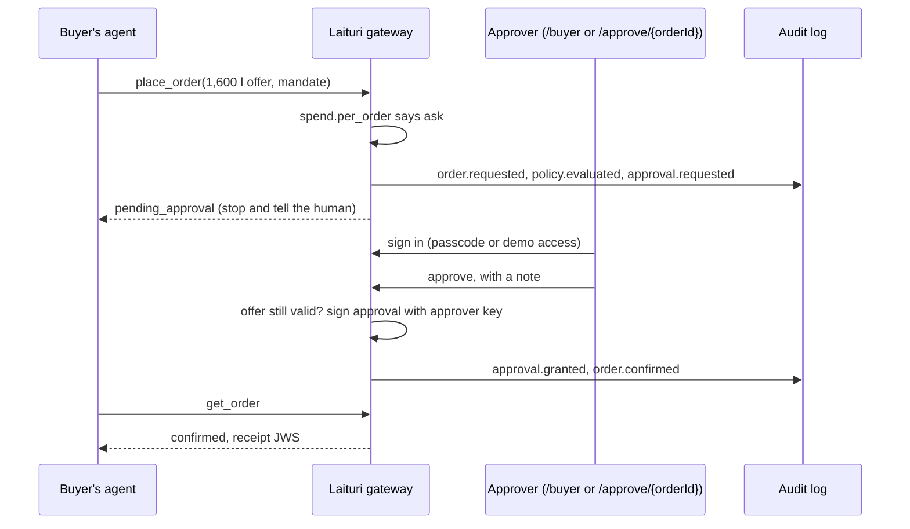
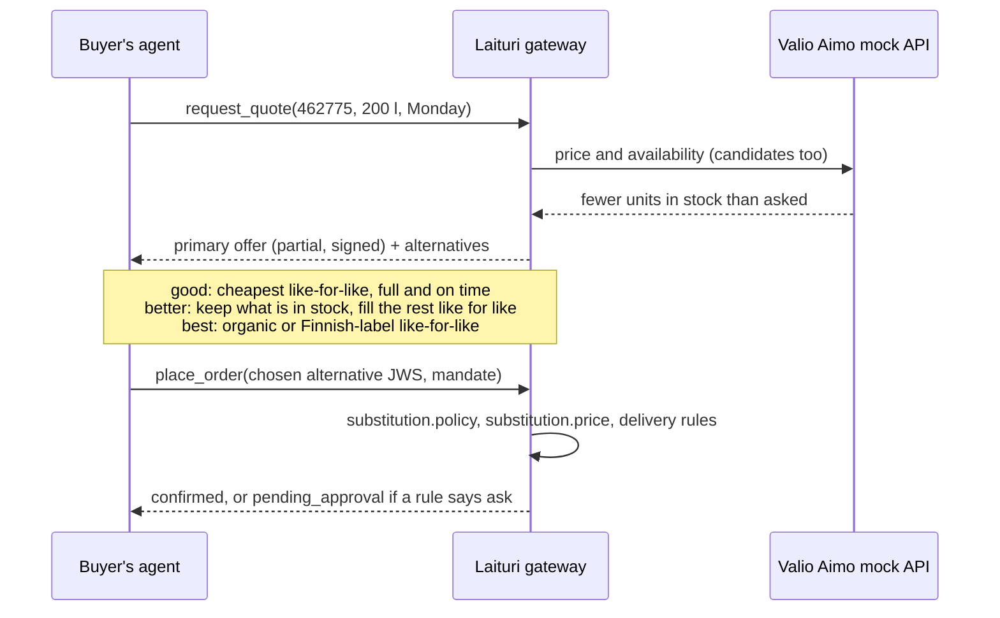
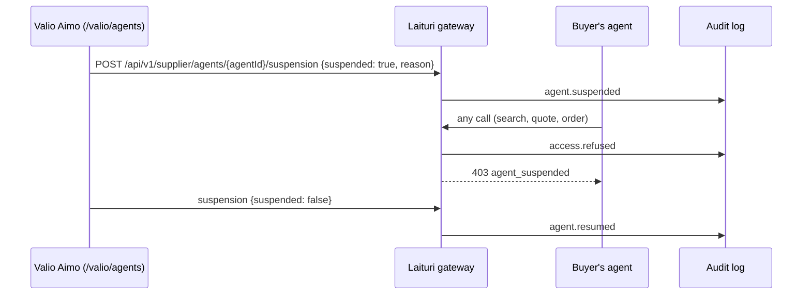

# Architecture

Laituri is one Next.js application. It plays three parties in the demo: the buyer (a kitchen and its approver), the wholesaler (Valio Aimo) and the agent's front door between them. Every agent call, from MCP, REST or the screens, goes through one gateway.

## Components

| Component | Path | What it does |
|---|---|---|
| Contracts | [`src/lib/contracts`](../src/lib/contracts) | zod schemas for every request and response. The OpenAPI document, the MCP tool schemas and the screens use them. |
| Gateway | [`src/lib/gateway`](../src/lib/gateway) | One facade: search, quote, mandate, order, approval, audit, suspension, supplier overview. Admits or refuses each agent call. |
| REST | [`src/app/api/v1`](../src/app/api/v1) | Route handlers. Each reads its body with a contract and calls the gateway. Errors are RFC 9457 problem details ([`src/lib/http/respond.ts`](../src/lib/http/respond.ts)). |
| MCP | [`src/lib/mcp`](../src/lib/mcp), [`src/app/mcp/route.ts`](../src/app/mcp/route.ts) | Streamable HTTP server. Each tool mirrors one REST operation; each result is parsed against its output schema. |
| OpenAPI | [`src/lib/openapi`](../src/lib/openapi) | The operation registry and the OpenAPI 3.1 document built from it. |
| Upstream client | [`src/lib/valio`](../src/lib/valio) | Calls the challenge's mock API (price, availability) with the server-side key, or replays recorded answers. Normalises upstream fields. |
| Catalogue | [`src/lib/catalog`](../src/lib/catalog) | Product index, concept lexicon (Finnish, Swedish, English), search and ranking, like-for-like candidates. |
| Offers | [`src/lib/offers`](../src/lib/offers) | Pack maths, offer lines with product facts, signed offers, good/better/best alternatives. |
| Policy | [`src/lib/policy`](../src/lib/policy) | The mandate rules. Pure: every input is passed in. |
| Mandate | [`src/lib/mandate`](../src/lib/mandate) | The demo buyers' terms, signed with the buyer key; reading and re-signing a changed mandate. |
| Orders | [`src/lib/orders`](../src/lib/orders) | Placement, idempotency, single use of offers, approval, signed receipts. One lock serialises decisions. |
| Audit | [`src/lib/audit`](../src/lib/audit) | Hash chain of signed entries, verification, signed checkpoints. |
| Trust | [`src/lib/trust`](../src/lib/trust) | Key generation and storage, JWS signing and verification, canonical JSON. |
| Insights | [`src/lib/insights`](../src/lib/insights) | The wholesaler's overview: connected agents, demand, unmet requests, offer conversion, fired rules. Pure. |
| Seed | [`src/lib/seed`](../src/lib/seed) | Plays about a week of demo requests through the real gateway at past times. |
| Agent | [`src/lib/agent`](../src/lib/agent) | The scripted buyer agent, and model-driven agents (Claude, Gemini) behind one adapter in `agent/llm`. |
| Screens | [`src/app`](../src/app), [`src/components`](../src/components) | Landing page, buyer side, wholesaler side, connect page, phone approval page, walkthrough, `/evidence`. |

## Data flow

1. An agent calls a tool or route with its bearer token. [`src/lib/http/agent.ts`](../src/lib/http/agent.ts) maps the token to the agent and buyer named in that buyer's mandate.
2. The gateway refuses the call if the wholesaler has suspended the agent ([`src/lib/gateway/suspension.ts`](../src/lib/gateway/suspension.ts)), and records the call for the wholesaler's activity view.
3. Search reads the local index. A quote asks the upstream client for live price and availability, builds the lines and signs the offer with the supplier key.
4. An order carries the offer JWS and the mandate JWS. The order module verifies both, checks the offer has not been used, runs every policy rule and then confirms, waits for approval, or blocks.
5. Every step appends a signed entry to the audit chain. State lives in memory with a JSON snapshot in `.data/state.json` ([`src/lib/store/memory.ts`](../src/lib/store/memory.ts)).
6. The screens poll the REST routes, fetch the JWKS and re-check the chain and signatures in the browser ([`src/lib/console/verify.ts`](../src/lib/console/verify.ts)).

## The three keys and their custody

| Key | Signs | Who holds it in production | Who holds it in the demo |
|---|---|---|---|
| Supplier | Offers, receipts, audit entries, checkpoints | The wholesaler; Laituri runs with this key only | This server, `.data/keys` |
| Buyer | Mandates | The buyer, in its own purchasing system | This server, `.data/keys` |
| Approver | Approvals, the approver's sign-in session | The buyer's approver, with a personal credential | This server, `.data/keys` |

All three public keys are published at `/.well-known/jwks.json` with their `role`. An agent holds no key: it cannot sign a mandate, an offer or an approval, so it cannot raise its limit, change a price or approve its own order.

## Sequence: automatic order

## Sequence: approval

An agent token cannot approve over REST, and no MCP tool approves (evals G10 to G13). If the offer expired while waiting, the order is rejected and the reason logged.

## Sequence: exception with alternatives

## Sequence: suspension

## What runs where

- Server: the REST routes, the MCP endpoint, the gateway and everything it calls.
- Browser: the screens (`src/components`, with `src/lib/console`, `src/lib/supplier-console` and `src/lib/tour`), chain and signature verification with the published keys, speech input (Web Speech API).
- At start-up, [`src/instrumentation.ts`](../src/instrumentation.ts) seeds demo history when the state is empty.
